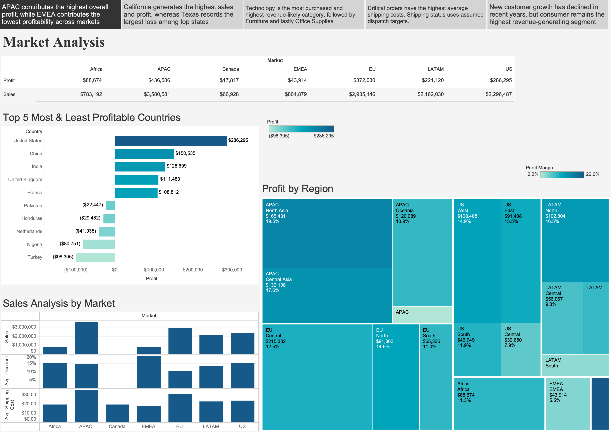
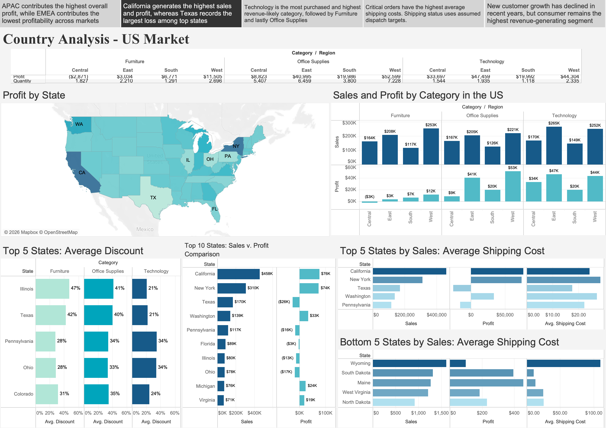
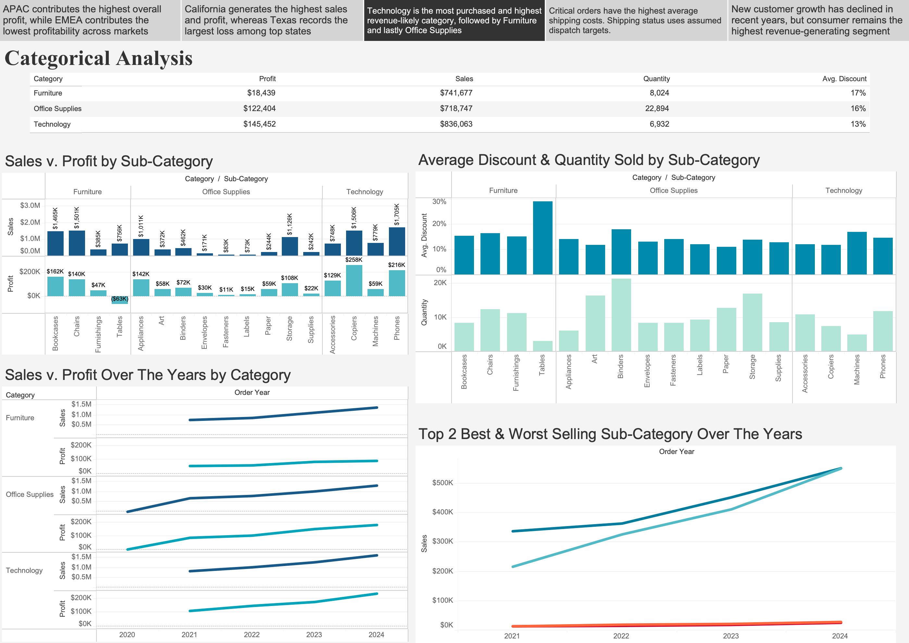
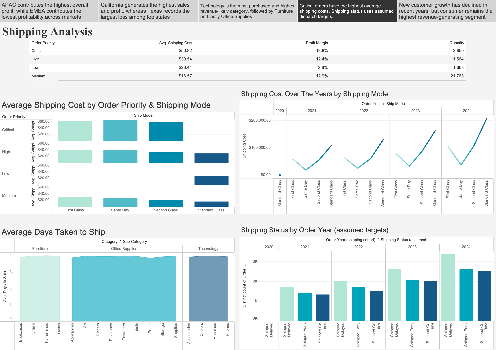
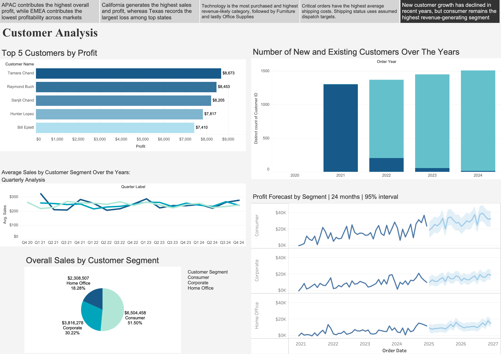

# Global Retail Business Analytics

A University of London Business Analytics coursework project exploring retail sales, profit, product performance, shipping and customer segments through five Tableau dashboards.

The project brings together the original coursework and a later portfolio reconstruction. It uses historical coursework data to explore business questions, rather than describe a company's current performance.

## Project files

### Original coursework

- [Business analytics report](coursework/240672870_report.pdf)
- [Original Tableau Story PDF](coursework/240672870_story.pdf)
- [Coursework dataset](data/ST2187_coursework_dataset_2025-26.xlsx)

The report and Story PDF document the original submission. The Excel file is the source dataset.

### Reconstructed portfolio

- [Download the Tableau packaged workbook](tableau/240672870_retail_analytics.twbx)
- [View the dashboard images](images/)

The original Tableau workbook was unavailable. This version was reconstructed from the coursework dataset, report and dashboard exports, then refined for portfolio presentation. Its calculations, formatting and forecast settings may differ from the original submission. The PDFs remain the reference for the original coursework.

## Dashboard previews and findings

### 1. Market analysis



Compares sales, profit, margins, discounts and shipping costs across markets and regions. The analysis highlights differences between revenue and profitability, making market-level comparisons more useful than a sales ranking alone.

### 2. US market analysis



Examines state-level sales and profit alongside discounts and shipping costs. The coursework identifies California as a strong contributor and Texas as a market with substantial sales but an overall loss. These patterns suggest areas to investigate, but do not establish that discounting or shipping costs caused the losses.

### 3. Category analysis



Compares categories, subcategories and trends over time. Tables show negative profit in the reconstructed subcategory comparison, illustrating why product performance needs to be assessed using profit as well as sales.

The summary table uses US data, while the charts below use global data. Their totals should not be compared as if they cover the same population.

### 4. Shipping analysis



Explores shipping modes, priorities, costs and the time between ordering and dispatch. Under the reconstruction's assumed dispatch targets, 9,752 of 25,001 distinct orders are classified as delayed, 7,823 as early and 7,426 as on time. These are illustrative classifications, not verified late deliveries.

### 5. Customer analysis



Consumer customers account for 51.50% of sales, followed by Corporate at 30.22% and Home Office at 18.28%. These are revenue shares, not profit shares or shares of customer count.

The dashboard also explores customer trends and segment profit forecasts. A customer's first appearance in the dataset does not necessarily represent their first purchase from the business.

## Methodology

The analysis uses the Excel coursework dataset as the source for Tableau. It compares sales and profit across markets, US states, product groups and customer segments, then examines trends and shipping measures through charts, maps and summary tables.

The reconstruction checks record counts, segment sales shares and order-level shipping classifications. The source contains 51,228 rows and 25,001 distinct orders. Order dates run from 31 December 2020 to 30 December 2024, including two records in 2020. Ship dates extend to 6 January 2025. These source dates define the reconstruction's coverage; dates described in the original coursework may differ.

### Shipping assumptions

The dataset contains order and ship dates, but no promised dispatch dates or arrival dates. Shipping status therefore uses assumed calendar-day targets:

| Shipping mode | Assumed days from order to dispatch |
|---|---:|
| Same Day | 0 |
| First Class | 1 |
| Second Class | 3 |
| Standard Class | 5 |

For each row, dispatch variance is the number of days between order and ship dates minus the assumed target. Each order receives its largest row-level variance. Positive values are classified as delayed, zero as on time and negative values as early. Orders are assigned to their earliest order year so each order is counted once.

Changing the assumed targets changes the results. Dispatch time does not measure delivery time or prove a service commitment was missed.

### Forecast assumptions

The reconstructed workbook uses Tableau's native exponential smoothing with additive trend and seasonality, a 24-month horizon and 95% prediction bands. Missing periods are filled with zero, and no final periods are ignored. These settings were specified for the reconstruction; the original workbook's settings could not be recovered.

The forecast is a model-based projection, not a guaranteed outcome or a validated business plan. Zero-filled periods and model assumptions can affect the estimates. Prediction bands show model uncertainty but cannot account for every future business change.

## Business implications

- Review loss-making states and subcategories before prioritising sales growth alone.
- Examine pricing, discounts, product mix and costs together before drawing conclusions about low profit.
- Use real service targets and delivery records before making logistics decisions from the shipping classifications.
- Consider both revenue contribution and profitability when planning customer segment activity.

These are areas for further investigation, not evidence that a particular intervention will improve results.

## Viewing the project

Read the report and Story PDF for the original coursework, or use the five image previews above for a quick overview.

To explore the reconstruction, download [tableau/240672870_retail_analytics.twbx](tableau/240672870_retail_analytics.twbx) and open it in compatible Tableau software. The predecessor packaged workbook was checked in Tableau Desktop 2026.2. Compatibility with other versions has not been established here.

## Limitations and sharing permissions

The data was supplied for academic analysis. Findings describe this dataset and do not establish causal relationships or current commercial performance. Dollar symbols are a display convention: the source does not identify a currency, and no exchange conversion was applied.

Public redistribution permission has not been established in this README. Before making the repository public, confirm permission to share the coursework materials and dataset, including any data embedded in the packaged Tableau workbook. Keep restricted materials private if permission is unavailable. This README does not grant a licence to reuse university-provided or third-party material.

## Repository structure

```text
global-retail-business-analytics/
├── README.md
├── coursework/
│   ├── 240672870_report.pdf
│   └── 240672870_story.pdf
├── data/
│   └── ST2187_coursework_dataset_2025-26.xlsx
├── tableau/
│   └── 240672870_retail_analytics.twbx
└── images/
    ├── 01_market_analysis.png
    ├── 02_us_market_analysis.png
    ├── 03_category_analysis.png
    ├── 04_shipping_analysis.png
    └── 05_customer_analysis.png
```
